# PDF Toolbox

PDF birleştirme, bölme, dönüştürme, düzenleme, yazdırma, OCR ve sayfa
numaralandırma işlemlerini tek bir masaüstü uygulamasında toplayan
**Rust / egui** sürümü.

Uygulama tamamen yerel çalışır; PDF'ler hiçbir sunucuya gönderilmez. PDF
görüntüleme için **pdfium kullanılmaz**; sayfalar saf Rust kütüphanesi
[`hayro`](https://crates.io/crates/hayro) ile işlenir.

> Geliştirici: **Emrullah ALKAÇ**

---

## Ekran Görüntüleri

|  |  |
| --- | --- |
| 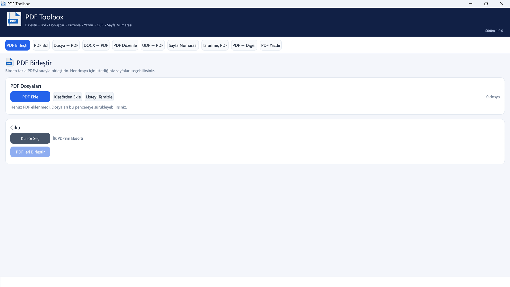 | 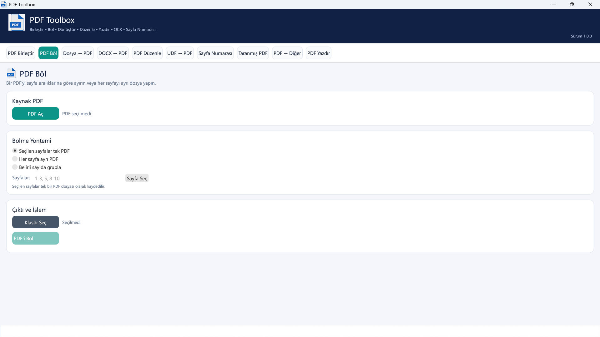 |
| 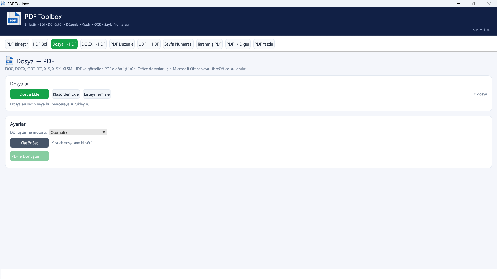 | 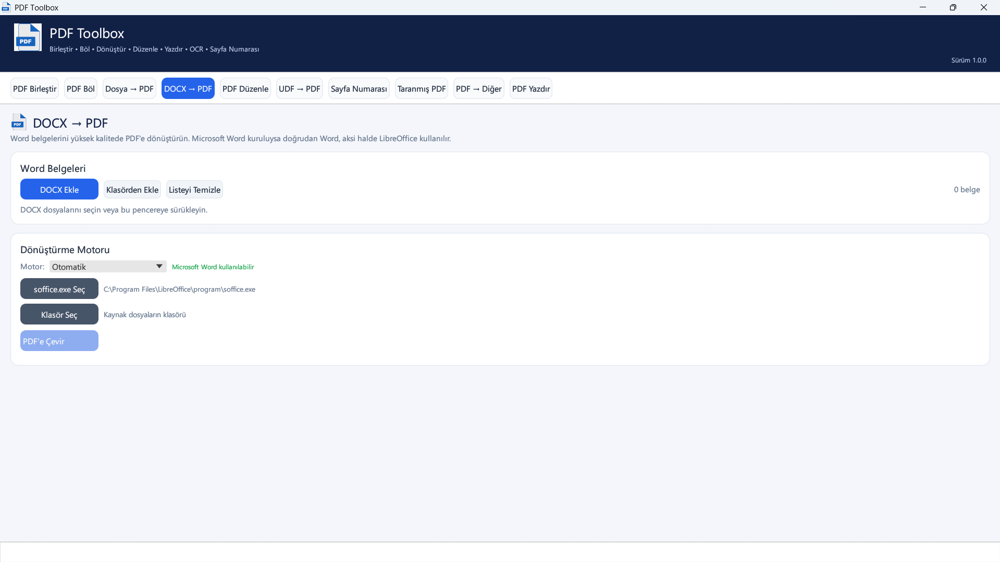 |
| 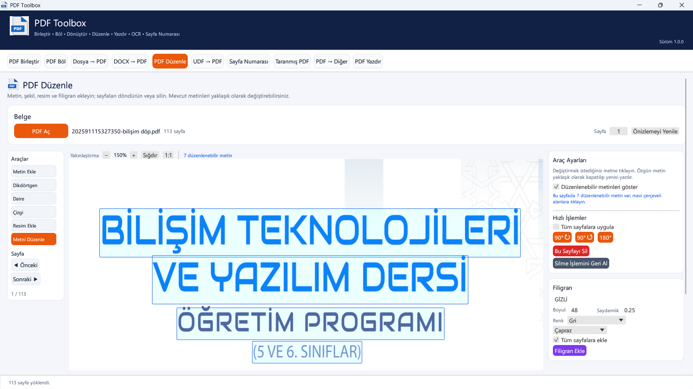 | 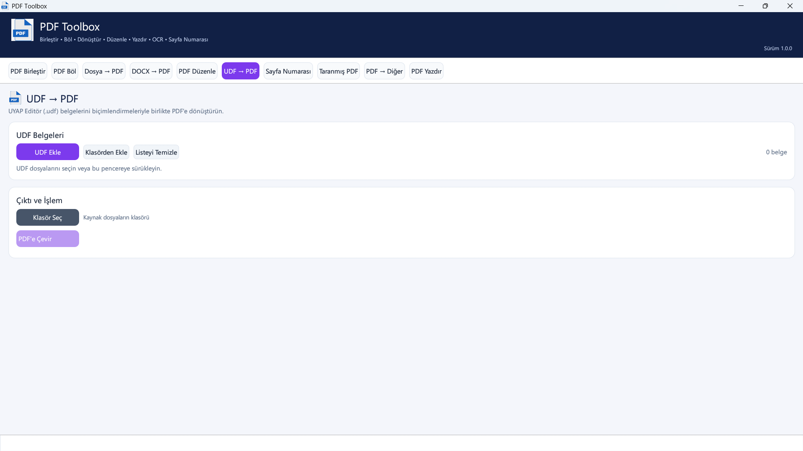 |
| 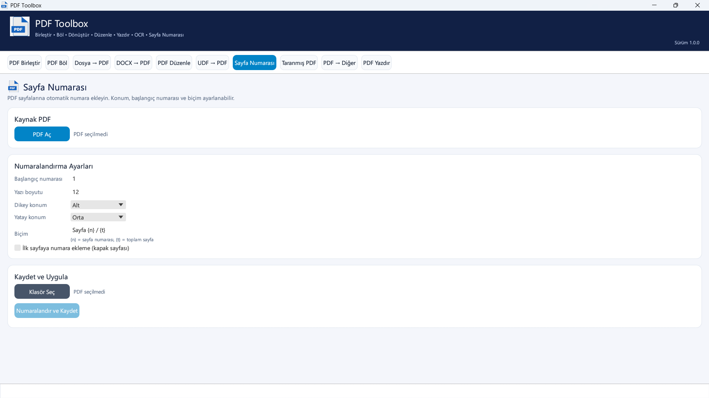 | 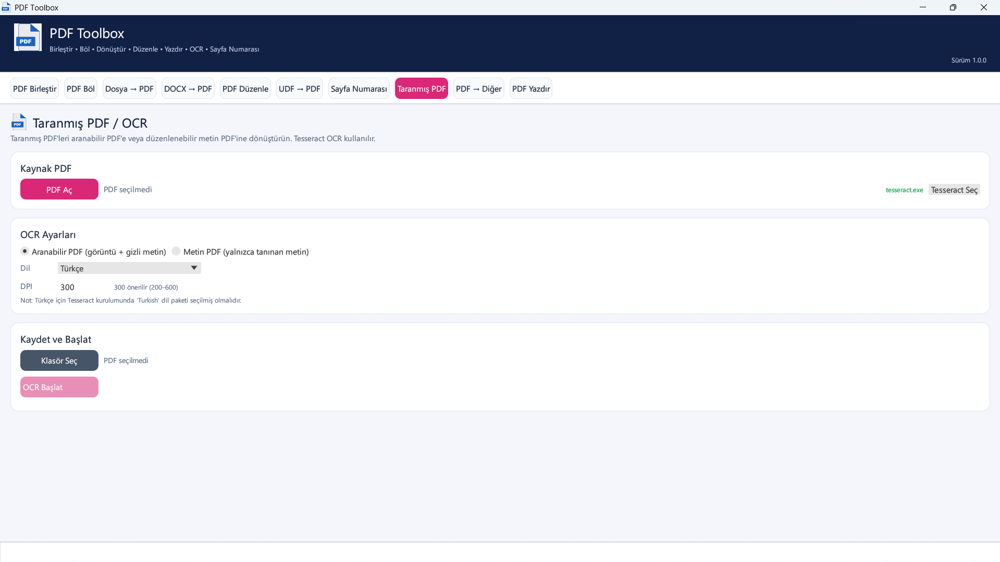 |
| 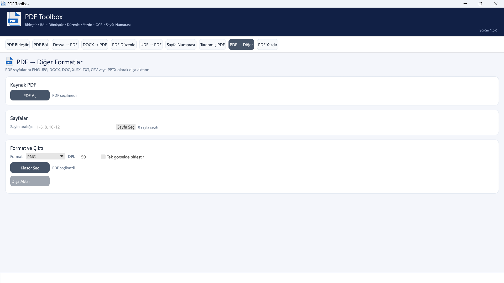 | 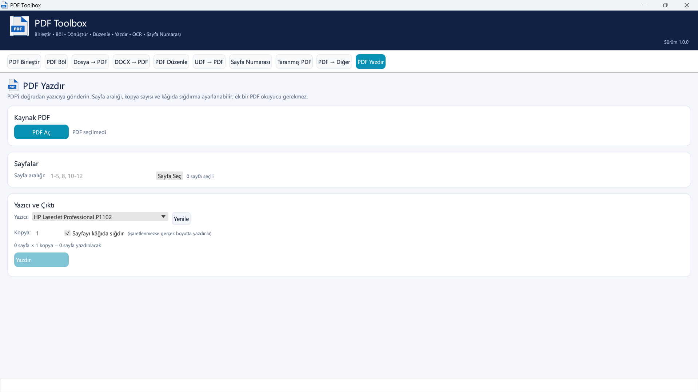 |
| 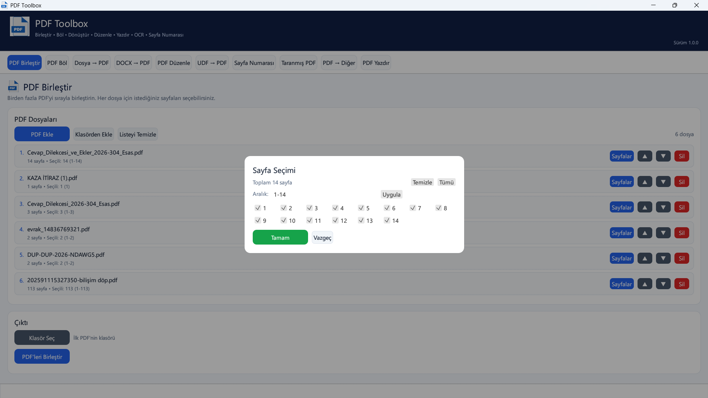 |  |

---

## Özellikler

| Sekme | Yapabildikleri |
| --- | --- |
| **PDF Birleştir** | Birden fazla PDF'yi sıralama, her dosyadan sayfa seçme, tek PDF üretme |
| **PDF Böl** | Sayfa aralıklarına göre bölme, ayrı dosyalar veya seçili sayfaları tek dosyada toplama |
| **Dosya → PDF** | PDF, DOC, DOCX, ODT, RTF, XLS, XLSX, XLSM, UDF, PNG, JPG, BMP, TIFF, WEBP dosyalarını PDF'e çevirme |
| **DOCX → PDF** | Word belgelerini toplu dönüştürme; Microsoft Word veya LibreOffice motoru |
| **PDF Düzenle** | Metin, dikdörtgen, daire, çizgi, görsel ve filigran ekleme; mevcut metni düzenleme (düzenlenebilir alanlar sayfada çerçevelenir); sayfa döndürme/silme; geri al/yinele; %10–%500 yakınlaştırma |
| **UDF → PDF** | UDF şablonlarındaki metin ve paragrafları PDF'e aktarma |
| **Sayfa Numarası** | Konum, yazı tipi boyutu, biçim ve başlangıç numarası seçimi |
| **Taranmış PDF** | Tesseract ile metin çıkarma veya aranabilir PDF üretme; otomatik yön düzeltme |
| **PDF → Diğer** | PNG, JPG, DOCX, DOC, XLSX, TXT, CSV ve PPTX çıktısı; DPI ve sayfa seçimi |
| **PDF Yazdır** | Sayfa aralığı ve kopya sayısı seçimiyle doğrudan yazıcıya gönderme; kâğıda sığdırma |

Ek olarak:

- Türkçe arayüz, sürükle-bırak dosya desteği, ilerleme çubukları ve durum mesajları
- İşlemler arka planda çalışır; arayüz donmaz
- Harici dönüştürücüler için zaman aşımı ve otomatik yedek yöntem
- Yerel dosya/klasör seçim pencereleri (`rfd`)
- Uygulama simgesi pencere başlığında, görev çubuğunda, üst başlıkta ve her sekmenin sayfa başlığında görünür

### PDF Düzenle yakınlaştırması

- Araç çubuğundaki **− / +**, **Sığdır** ve **1:1** düğmeleri
- **Ctrl + fare tekerleği** ile hızlı yakınlaştırma; görünüm sayfa merkezine hizalanır
- %10–%500 aralığı; fare tekerleği ile dikey, kaydırma çubukları ile gezinme
- Yüksek yakınlaştırmalarda sayfa, ekranın gerçek piksel yoğunluğunda yeniden
  oluşturulur; böylece metin ve çizgiler bulanıklaşmaz
- Düzenleme koordinatları yakınlaştırma ve kaydırmadan bağımsız olarak doğru
  sayfa noktasına eşlenir

### Mevcut metni düzenleme

- **Metni Düzenle** aracı seçildiğinde, sayfadaki düzenlenebilir metinler mavi
  çerçevelerle işaretlenir; fare bir metnin üzerine geldiğinde çerçeve turuncu,
  seçilen metin ise yeşil olur
- Üstteki yakınlaştırma çubuğunda o sayfadaki düzenlenebilir metin sayısı
  gösterilir; vurgulama araç ayarlarından kapatılabilir
- PDF'deki mevcut metne tıklandığında özgün metin, yazı tipinin **ToUnicode /
  CID** eşlemeleri çözülerek okunur; alt küme (subset) yazı tiplerinde görülen
  bozuk karakterler önlenir
- Metin boyutu, rengi ve arka plan rengi otomatik olarak önerilir; değiştirilen
  metin Türkçe karakterlerle birlikte yeniden çizilir
- Özgün metin nesnesi silinmez; arka plan rengiyle kapatılıp üzerine yeni metin
  yazılır, bu nedenle yazı tipi birebir korunmaz

### PDF yazdırma

- Yazıcı listesi Windows'tan okunur; varsayılan yazıcı otomatik seçilir
- Sayfa aralığı (`1-5, 8, 10-12`) ve kopya sayısı ayarlanabilir
- Sayfalar yazıcının çözünürlüğünde yeniden oluşturulup Windows GDI ile
  gönderilir; yazdırma için Acrobat/Edge gibi bir PDF okuyucu gerekmez
- **Sayfayı kâğıda sığdır** kapalıysa sayfa gerçek boyutta (72 pt = 1 inç)
  ortalanarak yazdırılır

---

## Gereksinimler

### Zorunlu

- **Windows 10/11** (64-bit)
- Derleme için **Rust 1.85+** ve Cargo
- Çalışma zamanında ek DLL gerekmez; tüm PDF işlemleri uygulamanın içindedir

### İsteğe bağlı

| Araç | Kullanıldığı yer | Not |
| --- | --- | --- |
| **Microsoft Word** | DOC/DOCX → PDF, PDF → DOC | COM otomasyonu; kuruluysa otomatik bulunur |
| **Microsoft Excel** | XLS/XLSX/XLSM → PDF | COM otomasyonu; kuruluysa Excel, aksi halde LibreOffice (Calc) kullanılır |
| **LibreOffice** | Office belgeleri → PDF, PDF → DOC/DOCX | `soffice.exe`; uygulamadan yol seçilebilir |
| **Tesseract-OCR** | Taranmış PDF / OCR | Türkçe için `tur.traineddata` gerekir |

Uygulama, bu araçları sırayla arar:

- Word: kayıt defterindeki `winword.exe` kaydı
- Excel: kayıt defterindeki `excel.exe` kaydı
- LibreOffice: `SOFFICE` ortam değişkeni, `PATH`, `Program Files` ve `LOCALAPPDATA`
- Tesseract: `TESSERACT` ortam değişkeni, `PATH`, `Program Files\Tesseract-OCR`

Arayüzdeki **"soffice.exe Seç"** ve **"Tesseract Yolu"** düğmeleriyle özel
kurulum yolları da gösterilebilir.

---

## Derleme

```powershell
cd "C:\Users\Casper\Documents\Varsayılan Proje"

# Geliştirme derlemesi
cargo build

# Tek dosyalık, optimize sürüm
cargo build --release
```

Çıktılar:

- `target\debug\pdf-toolbox.exe`
- `target\release\pdf-toolbox.exe` (dağıtıma hazır)

Çalıştırma:

```powershell
cargo run --release
# veya
.\target\release\pdf-toolbox.exe
```

> Release profili `lto = "thin"`, `codegen-units = 1` ve `strip = true`
> kullanır. İlk release derlemesi birkaç dakika sürebilir.

### Uygulama simgesi

Simge kaynağı `assets/app.ico` dosyasıdır (16, 32, 48, 64, 128 ve 256 piksel
kareler). Aynı dosya hem exe kaynağına hem de arayüze gömülür:

- `build.rs`, ICO dosyasını okuyup `RT_ICON` + `RT_GROUP_ICON` içeren bir
  `.res` kaynak dosyası üretir ve bağlayıcıya verir. Böylece **`rc.exe`
  gerekmez**; exe Gezgin'de ve görev çubuğunda bu simgeyle görünür.
- `src/icon.rs`, simgeyi `image` kutusunun `ico` özelliğiyle çözer; pencere
  simgesi (`with_icon`) ve arayüzdeki doku buradan gelir.

Simgeyi değiştirmek için `assets/app.ico` dosyasını yenisiyle değiştirip
yeniden derlemek yeterlidir.

---

## Testler

```powershell
cargo test
```

Kapsanan senaryolar (`src/smoke.rs`):

- PDF birleştirme, sayfa çıkarma, render, düzenleme, döndürme, silme ve numaralandırma
- ToUnicode/özel kodlamalı yazı tiplerinden Türkçe metin çıkarma ve düzenlenen metni geri okuma
- PNG/JPG/TXT/CSV/XLSX/DOCX/PPTX dışa aktarma ve geçerli OOXML üretimi
- XLSX → PDF yönlendirmesi (Excel/LibreOffice) ve LibreOffice ile gerçek tablo dönüştürme
- Yazıcı listeleme ve yazıcı aygıt bağlamı (kâğıt alanı/DPI) sorgulama
- UDF (düz XML ve ZIP'li) → PDF
- Word COM ile DOCX → PDF
- LibreOffice olmadan PDF → DOCX metin yedeği
- LibreOffice olmadan PDF → DOC (Word/RTF yedeği) dışa aktarma
- Tesseract ile OCR (metin modu)
- Harici komut zaman aşımı ve süreç sonlandırma

LibreOffice'e bağlı test varsayılan olarak kapalıdır:

```powershell
cargo test smoke::libreoffice_docx_conversion -- --ignored --nocapture
cargo test smoke::libreoffice_spreadsheet_conversion -- --ignored --nocapture
```

LibreOffice takılırsa dönüştürme, varsayılan **240 saniye** sonunda iptal
edilir. Süreyi değiştirmek için:

```powershell
$env:PDF_TOOLBOX_CONVERT_TIMEOUT = "60"
cargo test smoke::libreoffice_docx_conversion -- --ignored --nocapture
```

Aynı ortam değişkeni uygulama çalışırken de geçerlidir.

---

## Dönüştürme davranışı

### Office → PDF

- **Otomatik**: Word kuruluysa DOC/DOCX/RTF/ODT için önce Word denenir,
  başarısız olursa LibreOffice'e geçilir. Excel kuruluysa XLS/XLSX/XLSM için
  önce Excel, olmazsa LibreOffice (Calc) kullanılır.
- **Microsoft Word**: yalnızca Word COM kullanılır (Word belgeleri).
- **LibreOffice**: yalnızca `soffice --headless` kullanılır.

Word belgeleri salt okunur açılır ve PDF olarak dışa aktarılır. Excel çalışma
kitapları `ExportAsFixedFormat` ile PDF'e çevrilir; tüm sayfalar ve çalışma
sayfaları yazdırma alanına göre aktarılır. Harici süreç belirlenen süre içinde
bitmezse süreç ağacı sonlandırılır ve anlaşılır bir hata gösterilir.

### PDF → DOC / DOCX

1. LibreOffice'in Writer PDF içe aktarıcısı denenir.
2. LibreOffice yoksa veya başarısız olursa PDF metni çıkarılır:
   - DOCX: doğrudan geçerli OOXML olarak yazılır.
   - DOC: Word varsa RTF ara dosyası gerçek `.doc` biçimine çevrilir; Word yoksa
     Word/LibreOffice'in açabildiği RTF tabanlı `.doc` yazılır.
3. Taranmış ve metni olmayan PDF'lerde önce **Taranmış PDF** sekmesinde OCR
   çalıştırılmalıdır.

### OCR

- Sayfalar seçilen DPI'da render edilir, gri tonlama + kontrast artırma uygulanır.
- Tesseract OSD ile sayfa yönü tespit edilir ve gerekirse döndürülür.
- **Metin** modu: yalnızca metin katmanı olan yeni bir PDF üretir.
- **Aranabilir PDF** modu: görsel sayfa korunur, üzerine görünmez OCR metni eklenir.
- Her Tesseract çağrısı 180 saniye zaman aşımına sahiptir.

---

## Proje yapısı

```text
src/
  main.rs          Uygulama girişi ve pencere ayarları
  icon.rs          Gömülü uygulama simgesi (pencere + arayüz dokusu)
  app.rs           Ana durum, sekmeler, mesajlar, yerel dosya pencereleri
  app_merge.rs     PDF Birleştir / PDF Böl
  app_convert.rs   Dosya → PDF, DOCX → PDF, UDF → PDF
  app_edit.rs      PDF Düzenle tuvali ve düzenleme pencereleri
  app_tools.rs     Sayfa Numarası, OCR, PDF → Diğer
  model.rs         Sekme, düzenleme ve metin nesnesi modelleri
  jobs.rs          Arka plan işleri ve ilerleme mesajları
  pdfcore.rs       PDF yükleme, birleştirme, render, düzenleme, numaralandırma
  overlay.rs       printpdf ile metin/görsel/filigran katmanları
  textobj.rs       Mevcut PDF metin nesnelerini yazı tipi kodlamalarıyla ayrıştırma
  convert.rs       Word / LibreOffice / görsel dönüştürme
  ocr.rs           Tesseract işlem hattı
  print.rs         Yazıcı listesi ve Windows GDI ile PDF yazdırma
  export.rs        PDF → görsel, metin ve Office dışa aktarma
  ooxml.rs         DOCX / XLSX / PPTX yazıcıları
  udf.rs           UDF şablon ayrıştırma
  fonts.rs         Gömülü yazı tipi seti (sans/serif, normal/kalın)
  util.rs          Sayfa aralığı, dosya adı, zaman aşımı yardımcıları
  smoke.rs         Uçtan uca duman testleri
```

Diğer dosyalar:

```text
build.rs           assets/app.ico → exe kaynağı (.res) üretimi
assets/app.ico     Uygulama simgesi (tüm boyutlar)
```

### Teknik notlar

- **Render**: `hayro` + `image`; PDF sayfaları RGBA olarak çizilir.
- **PDF işleme**: `lopdf` (birleştirme, sayfa kopyalama, Form XObject ekleme).
- **Katman üretimi**: `printpdf`; metin, şekil, görsel ve filigran katmanları
  geçici PDF olarak üretilip `lopdf` ile ana belgeye eklenir.
- **Arayüz**: `eframe` / `egui` 0.31 (glow). Pencere varsayılan olarak
  **1120 × 620** mantıksal piksel açılır, en küçük **900 × 600**'dür.
- **Metin çıkarma**: `pdf-extract` ile yazı tipi kodlamaları (ToUnicode, CID,
  Differences) çözülür; çözümleme başarısız olursa ham `lopdf` çıkarımına geri
  dönülür.
- **Mevcut metni düzenleme**: PDF metin nesnesi silinmez; nesnenin arka plan
  rengi örneklenerek üzeri kapatılır ve yeni metin çizilir. Bu nedenle özgün
  yazı tipi birebir korunmaz. Düzenlenebilir metin alanları, `textobj` ile
  çıkarılan metin nesnelerinin sınır kutularından (bounds) yararlanılarak
  sayfada çerçevelenir.
- **Yazdırma**: Sayfalar yazıcı DPI'sında `hayro` ile görüntülenir (en fazla
  ~288 DPI), 32 bit BGRA DIB'e çevrilir ve `StartDoc`/`StartPage`/
  `StretchDIBits`/`EndDoc` çağrılarıyla gönderilir. Ek DLL veya harici PDF
  okuyucu gerekmez.
- **Simge**: `build.rs` ICO dosyasından doğrudan Windows `.res` kaynağı
  üretir (32 baytlık başlık, `RT_ICON` girdileri, `GRPICONDIR` verisi) ve
  `cargo:rustc-link-arg` ile `link.exe`'ye verir. `rc.exe`/Windows SDK
  gerekmez; simge üretilemezse derleme uyarı verip simgesiz devam eder.
- **Kalıcılık**: Uygulama ayarları diske yazılmaz; her açılışta sonuç klasörü
  kaynak dosyanın yanıdır.

---

## Sorun giderme

| Belirti | Çözüm |
| --- | --- |
| "LibreOffice bulunamadı" | LibreOffice kurun veya `soffice.exe` yolunu seçin |
| LibreOffice dönüştürmesi takılıyor | Uygulama 240 sn sonra iptal eder; Word motorunu deneyin |
| "Tesseract dil paketi eksik" | Kurulumda `Turkish` paketini seçin veya `tur.traineddata` dosyasını `tessdata` klasörüne kopyalayın |
| OCR sonucu boş | DPI'yı 300–400 yapın, doğru dili seçin, taranmış görüntünün net olduğundan emin olun |
| DOCX → PDF renkleri farklı | Word ile LibreOffice arasında yazı tipi/yerleşim farkı olabilir; motoru değiştirin |
| "Microsoft Excel bulunamadı" | Excel kurun veya LibreOffice (Calc) kurup `soffice.exe` yolunu seçin |
| XLSX → PDF sayfa düzeni bozuk | Excel'de yazdırma alanı/ölçek ayarını düzenleyin veya LibreOffice motorunu deneyin |
| Yazıcı listesi boş | Windows'a yazıcı ekleyin, ardından **PDF Yazdır** sekmesinde **Yenile**'ye basın |
| "Yazıcı açılamadı" | Yazıcının açık ve sürücüsünün çalışır olduğunu kontrol edin |
| PDF açılmıyor | Dosya şifreli veya bozuk olabilir; parola korumalı PDF'ler desteklenmez |

---

## Lisans ve katkı

Bu proje kişisel bir masaüstü aracıdır. Kullanılan açık kaynak kütüphanelerin
lisansları geçerlidir. Hata bildirimi ve öneriler için geliştiriciyle iletişime
geçebilirsiniz.

**Geliştirici: Emrullah ALKAÇ**
